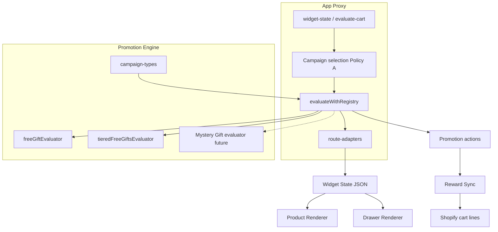

# Promotion Engine Architecture

**Status:** Source of truth for architecture (documentation only).
**Scope:** Spend X → Free Gift, Tiered Free Gifts, Mystery Gift.
**Code anchors:** `app/services/promotion-engine/`, `app/services/proxy-evaluation.server.ts`, storefront Product Renderer / Drawer Renderer.

---

## Purpose

The Promotion Engine is the **single server-side authority** for:

1. Selecting which campaign wins for a shop/cart.
2. Evaluating eligibility and rewards for that campaign.
3. Emitting a stable **Widget State** contract for storefront renderers.
4. Emitting evaluation **actions** that Reward Sync may apply to the cart.

Storefront scripts **must not** invent eligibility, thresholds, or gift selection. They consume Widget State (and sync payloads derived from evaluation actions).

---

## Target campaign types

| Merchant / admin type string | Registry key | Engine status |
|---|---|---|
| `Spend X -> Free Gift` | `FREE_GIFT` | Live evaluator |
| `Tiered Free Gifts` | `TIERED_FREE_GIFTS` | Live evaluator |
| `Mystery Gift` | *(not registered yet)* | Planned; UI stub / unsupported at runtime |

Mapping lives in `app/services/promotion-engine/campaign-types.ts` (`resolveRegistryCampaignType`).
Merchant visibility (creatable vs coming-soon) lives in `app/lib/merchant-campaign-types.ts`.

Percentage Discount and Fixed Discount exist in the **live registry today** but are **out of product scope** for this architecture. See [deviations-and-roadmap.md](./deviations-and-roadmap.md).

---

## Responsibilities

### Promotion Engine owns

- Campaign type → registry resolution (`campaign-types.ts`).
- Active campaign **selection** (`campaign-selection.ts`: `selectActiveCampaign` / `selectWinningCampaign`).
- Per-type **evaluation** via registry (`evaluate.ts`: `evaluateWithRegistry`).
- Qualifying subtotal helpers (`qualifying-subtotal.ts`, `resolve-subtotal.ts`).
- Canonical types (`types.ts`: cart, rules, rewards, actions, `PromotionEvaluationResult`).
- Adapters into engine shapes (`adapters.ts`: `toCanonicalCampaign`, `toEvaluationInput`).
- Public App Proxy JSON shaping (`route-adapters.ts`: `toWidgetStateResponse`, `toEvaluateCartResponse`).

### App Proxy orchestration owns

- Wiring request → selection → evaluate → adapt.
  Entry: `app/services/proxy-evaluation.server.ts`
  Used by widget-state and evaluate-cart routes.

### Widget / presentation layer owns

- Colors, merged widget settings, disabled payloads.
  `app/services/widget.server.ts`, `widget-presentation.server.ts`.

### Storefront renderers own

- **Product Renderer** (`free-gift-progress-bar.js` / classic bundle): product page and theme blocks **outside** the cart drawer.
- **Drawer Renderer** (`cart-page-progress.js`): **sole** owner of cart-drawer and cart-page progress UI.

### Reward Sync owns

- Applying cart line mutations from evaluation **actions** (add / remove / normalize gift lines).
  Independent of which renderer painted the UI.
  Classic: gift-sync path; modern: `tiered-gift-sync.js` (and related). Sync **must not** recompute eligibility.

---

## End-to-end flow



**Important:** Reward Sync is a **sibling** of rendering. It consumes evaluation actions (or an evaluate-cart response derived from them). It does **not** go through Widget State as its eligibility source of truth.

Live orchestration comment in package entry (`app/services/promotion-engine/index.ts`):

> Live App Proxy orchestration: `proxy-evaluation.server.ts` → `selectActiveCampaign({ supportedTypesOnly: true })` → `evaluateWithRegistry` → route adapters.

---

## Campaign selection (Policy A)

App Proxy evaluation enables **`supportedTypesOnly: true`** so an ACTIVE but **unsupported** campaign type cannot shadow a lower-priority supported campaign (see `proxy-evaluation.server.ts` header).

Selection result feeds a single winning campaign into `evaluateWithRegistry`. Unsupported types (including Mystery Gift today) resolve to `null` in `resolveRegistryCampaignType` and yield an explicit `UNSUPPORTED_CAMPAIGN_TYPE` diagnostic from the registry — they must **never** be silently coerced to Free Gift (`campaign-types.ts`).

---

## Widget State contract (summary)

Canonical storefront payload type: `StorefrontWidgetStateResponse` in `app/services/widget.server.ts`.
Built for the engine path by `toWidgetStateResponse` in `route-adapters.ts`, via `buildWidgetStateProxyResponse` in `proxy-evaluation.server.ts`.

Renderers treat this JSON as the **only** render contract for progress, copy, gift previews, and tier milestones. Full field rules: [widget-state.md](./widget-state.md).

---

## Product Renderer vs Drawer Renderer

| Concern | Product Renderer | Drawer Renderer |
|---|---|---|
| Primary assets | Classic / theme `free-gift-progress-bar.js` | `cart-page-progress.js` |
| Mount targets | Product / theme surfaces | Cart drawer + cart page strip |
| Cart drawer | **Must not** own or remount into drawer | **Sole** owner |
| Dawn / AJAX rebuilds | Must not fight drawer DOM | Must re-attach after Dawn rebuilds |

**Dawn rule:** Dawn can wipe and rebuild cart-drawer contents. Only the Drawer Renderer may re-park UI into the drawer. Product Renderer mounting into the drawer is an architectural violation (see deviations doc for historical debt).

---

## Core invariants

These are non-negotiable for Free Gift, Tiered Free Gifts, and Mystery Gift:

1. **Engine-only eligibility** — Thresholds, unlocked gifts, and Mystery Gift picks are decided on the server (Promotion Engine), never invented in the browser.
2. **Widget State-only render contract** — Progress UI reads Widget State (or an equivalent disabled payload). No parallel “local eligibility” as source of truth for production UI.
3. **Sync never computes eligibility** — Reward Sync applies actions / sync instructions derived from evaluation; it does not decide whether the customer qualifies.
4. **Product Renderer never owns the drawer** — Drawer DOM belongs to the Drawer Renderer only.
5. **CPP is sole drawer owner** — `cart-page-progress.js` is the only script authorized to own cart-drawer progress UI.
6. **Mystery Gift selection is always server-side** — When Mystery Gift is implemented, random/pool selection runs in the engine (or a dedicated server step it owns), never in storefront JS.

---

## Gift line property contract

Do not change existing keys (documented in `types.ts`):

- `_fgpb_free_gift` = `"true"`
- `_fgpb_campaign_id` = campaign id string
- `_fgpb_tier_id` = tier id string (Tiered Free Gifts only)

---

## Dependency direction

```text
Promotion Engine → Route Adapters → Storefront
```

Never reverse: storefront must not redefine engine rules. Legacy wrappers such as `gift-engine.server.ts` may still exist for older gift-shaped paths; new work goes through the Promotion Engine package.

---

## Related docs

- [widget-state.md](./widget-state.md) — canonical Widget State schema
- [promotion-interface.md](./promotion-interface.md) — evaluator / registry contract
- [deviations-and-roadmap.md](./deviations-and-roadmap.md) — decisions vs temporary debt vs roadmap
